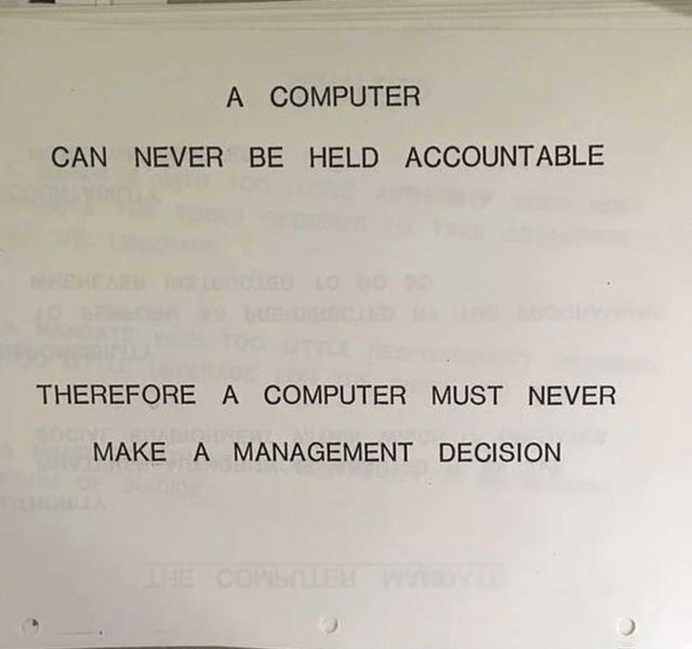

> **WARNING:** This article goes into polarizing topics about AI and strong language some may view as offensive. Reader discretion is advised.

> ※ If you have pathetically short attention span, [jump to my stance on AI in general](#my-stance-on-ai). Or just summarize this particular article into your beloved AI chatbot darling - you have my permission.

AI psychosis has hit a new low, and seeing it show up everywhere is getting annoying. Annoying enough that I have a shit ton of words to say about it, and not enough to fit in one go.

## AI Psychosis? Wot AI?

Before I go into the meat (or tofu) of this article, let's setup a few baseline understanding about the "AI psychosis" term used throughout this article.
- this is **NOT** a clinical term, but an informal term. Even then this article refers to the more colloquial meaning of the term used online.
- "AI psychosis" term in this article does **NOT** specifically refer to paranoia/delusional attachment on AI chatbot, as if it's a sentient being.
- When I say "AI psychosis", I'm specifically talking about a phenomenon where an individual and/or entity is having their identity all about AI.
    - Additionally, the term **"AI bro"** refers to said individual whose identity is all about AI.

I also want to set baseline understanding about the term **"AI"** in broader sense as it's easy to be misinterpret.
- The term **"AI"** in this article does **NOT** refer to procedural systems, including but not limited to:
    - NPC behavior in video games,
    - procedural content generation (PCG)
    - procedural graphics
    - procedural music
- While falls under the broader **AI** term, this article distinguishes these:
	- **Large language model (LLM)**, which outputs text
	- **generative AI**, which is generating auditory and visual content from text.
	- Machine 
## Psychotic AI Evangelism

I have lost count on how many accounts I see online on various social medias glazing AI like it's going to kill/replace some job sectors, *despite* the raw output being presented as final and they're genuinely utter shit beyond reasonable doubt. Those who called it utter shit because it looks objectively utter shit? They'd be called wrong on their face, and leave with L + ratio + cry bozo.

The evangelism with AI reeks a lot like multi-level marketing or pyramid scheme. I wouldn't be surprised if there's actually MLM agendas of AI bros the same size of the more obvious non-AI MLM entities.
### With Great Power...

"...comes great responsibility."

Unfortunately, that is not what I would say with the current state of AI evangelism and AI bro culture as a whole.

The other day DHH put out a tweet that I'm fully disagree with, but also stating the quiet part out loud on the matter:

> "The real AI psychosis is thinking "this is just another tool" or "it's just a stochastic parrot" and "humans still need to review every line". You gotta snap out of it."
> *[source tweet](https://x.com/dhh/status/2116109588554498081) / [archived](https://archive.ph/gVMEu)*

I don't think there's other possible interpretation of this tweet (and subsequence defensive bursts of his in the replies) other than him staunchly advocate for irresponsible AI usage. Because the stuff he's explicitly mentions (treating AI just like another tool or a stochastic parrot, and as a human, reviewing the stuff a LLM outputs) are part of being responsible when using AI.

Irresponsible (ab)use is one of the major problems with AI. AI at its core is a statistics machine, but also is, in fact, a stochastic parrot. It's impossible for AI to get deterministic unless you specifically pin stuff to "remember" or put in as context for every conversation (and even frontier models had hard time dealing with this). Add that to the temporal instability and the tendency to overdo something and overcorrecting to failure again, which is a recipe for disaster if left unattended, which is exactly an irresponsible action to do. Denying all this only makes things worse for everyone, except AI bros bagging the clout (and to some, money).

Case in point, AI recompilation projects of retro games popping up in recent weeks (until Anthropic put their lazy methods to a spine breaking halt - if only they could see it coming...). Some call it "slopcomp", "Claudecomp", "slop recomp". I personally am fine with AI recompilation of retro games, as long as it's done responsibly. However, almost all AI recompilation projects are sloppy emulator wrappers and treated like a disposable product with no responsibility to maintain in event of any issues or inaccuracies (that isn't done for the sake of quality-of-life features) showing up when people get to play the AI recompilation. Not to mention how fragmented the projects pop up, as if there's no concentrated effort to make a coherent recompilation that is both playable and workable to expand on. In other words, irresponsible.

As if AI bros changed the quote in the title and beginning of the section to be:

> "With great power **comes immense irresponsibility**."

To end this section, I'll quote a particularly relevant quote from IBM Training Manual typed in 1979:

*If only schools that teaches AI taught this important lesson.*

### Fuck the Local Models

Despite raging evangelism on AI, the amount of people/posts I found online who champions local LLM is astoundingly small. Throughout 2026 alone I could easily count them with just my fingers in one hand, excluding my own posts preferring fully local LLM. The rest goes to championing cloud frontier models.

Scroll enough For You page on your Twitter/X and you'll see AI bros staunching about how *specifically* cloud frontier models like Claude's Opus 5.5 or ChatGPT-6 Astra took a human game developer showcasing single mechanism in their project in one fell swoop, often done with mocking smug subtext in the caption. Or how someone posts AI slop video generated with Seedance 2.5 with a condescending caption that says along the line of "filmmaking is dead" or "taking over animators jobs". There's a nuance to be had on those kind of situation, which I'll go over in length for another time. But what I want to focus on is how all of those showcases of what AI can do are done with closed-source frontier models, and none are showcasing what local AI models can do with good setup.

If anything, for a long while, I have this theory (which I thought was conspiracy until now) about how the large AI overlords (i.e. OpenAI that's nowhere near open, and Anthropic) sabotage and cripple local LLM in such a way that it's getting far from practical for someone to use. Sure, the open source models themselves may not be crippled directly, but local LLMs are being crippled with ever increasing hardware prices, requiring more aggressive quantization for a meager spec home server that used to cost a third of the current prices. Therefore, those factors combined dumb down local LLM models enough to be barely practical in real world use cases and swerve them into paying for subscription and tokens on cloud frontier models.

The unanimous ostracization against local LLM and its sabotage coming out of fate spiraling from AI overlords frustrates me, because local LLM is superior in several aspect that I put importance on:
- Local LLM is all about **bring your own hardware** (BYOH).
- Practically, you cost more clean water from taking a bath and flushing your shit down the toilet than running local LLM.
- What you do with AI stays in your hardware, making it safe for private content, even one under non-disclosure agreements (NDA), until you expose it to the open internet.
- You have control over your own AI, including your own Terms of Service (or lack thereof from abliterated/uncensored models) and privacy.
- When not in use for AI, your hardware can be used for anything else you want, including gaming.

But who am I kidding, the talk about AI isn't about the hardware and physics anymore. Local LLMs are getting crippled by the days, and even larger efforts to push the use of local LLM from [people like PewDiePie are, in a way, getting sabotaged by AI overlords](https://youtu.be/ODDJXGY_1kQ). And I'm sure AI bros cheer in collective orgasm when Sam Altman said the quiet part out loud about **[how he wants all the RAM goes to data centers instead of your computer at home running local LLMs](https://youtu.be/iMsUcCYNKqY?t=1751).**

Side note: I'll admit that the aforementioned quote from Sam Altman prompted me to write this long ass article, because I can't condense it down to one Twitter/X tweet or hard to read thread. And I'm sure as fuck won't buy Twitter/X premium without a business expense.

### Frustratingly Political

> This section touches real life political/culture war slop as a nagging evil to mention, but it's meant to be objective, impartial, and serve as standalone filler. It also won't touch into anything military/warfare related. In any case, feel free to [skip to the next section](#silver-colored-bronze-bullet).

One pattern I notice about the whole AI opinion spectrum is how often it maps the same way into both political and culture war opinion spectrum. It's not always the case, but it's repeating too often that I had to pull the nagging evil out of my mind.

There's this pattern where on one extreme is vehemently anti-AI and couldn't be assed to look into the nuance of how the AI is being used or distinguishing between all sorts of AI. This camp has a firm standing of "all AI is bad, fuck the nuances."

Then, the other extreme shows a huge amount of "AI psychosis" in almost the exact same fashion as AI bros would. Glazing over AI slop content even in front of neutrally aligned artists that aren't keen with AI slop, and even with the output from the AI being genuinely trash and is not pleasing to enjoy with how apparent the slop is.

This is repeating far too often that as someone standing firm in the middle, I felt frustrated seeing both extreme making it so binary - either you're in on the AI psychosis or blindly anti-AI, no in-between stances.

## Silver-colored Bronze Bullet

AI bros wanted you, nay, gaslight you even, to believe that AI is this silver bullet that can do anything and you just have to shut your brain off. What they don't want you to acknowledge is that this "silver bullet" is just a bronze bullet with silver coating being sold at the cost of pretty much everything else.

The moment you use it in practice, even setting aside your opinion about AI, it's clear that AI doesn't do as much as the AI bros made it out to be. You hit the limit before you barely get something done with it thanks to the AI making mistakes where you're the one who have to pay for it all. You're basically at the mercy of either the token limits you have to pay up for, or pay upfront for an inferior AI running in your own hardware. Both costs exorbitant amount of money, and the former adds up as you use it. You're in for a disappointment because AI bros sold you false promises.

In the ideal scenario, people would've used AI as a way to make mundane repeating procedural tasks to be automated in one click away, then expand upon it in a deterministic way, thus helping the humans finish tasks faster and better. But that's the only "ideal scenario" and it's called that way for a reason.

## My Stance on AI

As for my stance on the whole AI, I'm standing somewhere in the middle - I believe it's a good tool, but I don't believe it as if it's a silver bullet everyone's hyping out to be, nor is it going to be a job killer people fear about. I'm also a staunch proponent for a fully local and truly open model AI so that everyone can run it locally.

Artificial Intelligence can be a good tool in good hands. But as it stands, there's too many irresponsible hands taking the charge of AI, and one needs to be so delusional to believe (over)dependence on AI overlords are the next greatest thing since sliced bread - it's anything but.
